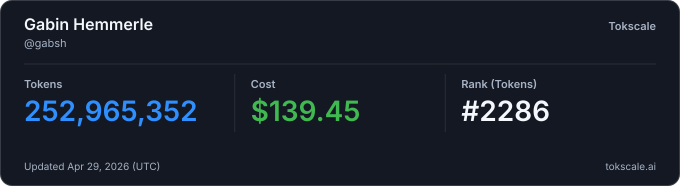

### `gabsh@github ~ $ ./contributions.sh`

### `gabsh@github ~ $ whoami`

All art is hand-rolled animated SVG, regenerated daily by a [workflow](.github/workflows/update-profile-art.yml).

---

    <a href="https://gabin-hemmerle.fr/portfolio">Portfolio</a> ·
    <a href="https://linkedin.com/in/gabin-hemmerle">LinkedIn</a> ·
    <a href="mailto:gabin.hemm@gmail.com">gabin.hemm@gmail.com</a> ·
    <a href="https://leetcode.com/u/gabsh/">LeetCode</a>

---

## 📊 Tokscale

  

